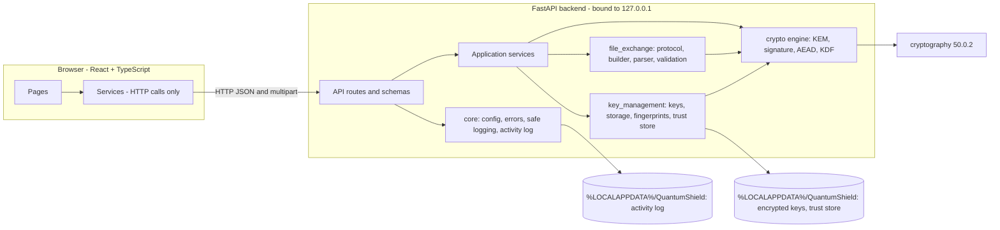
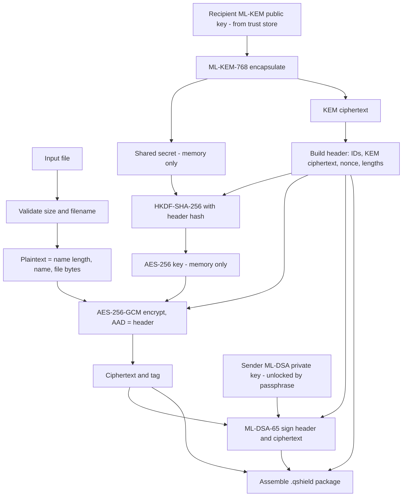
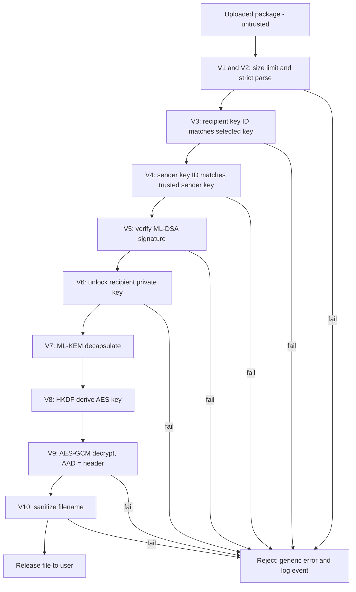
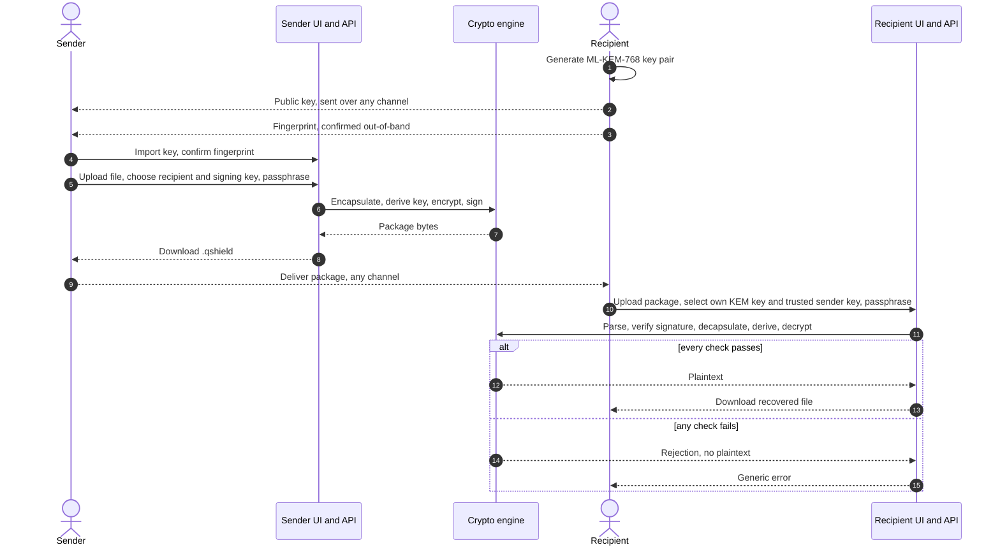
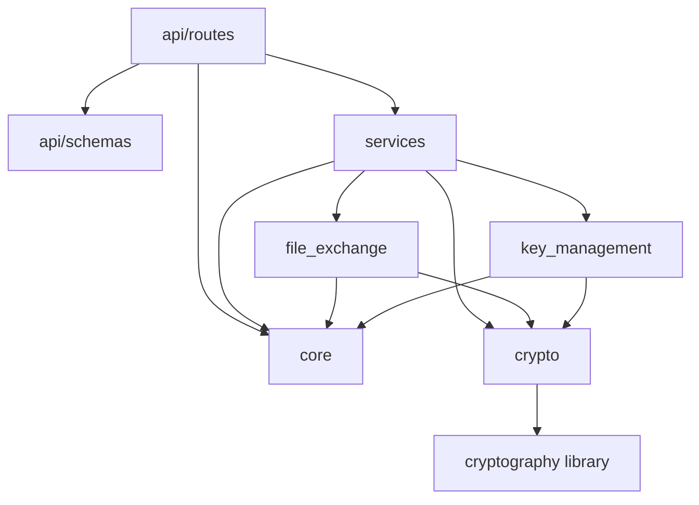
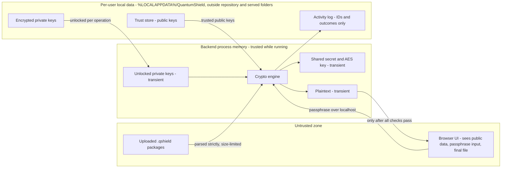

# QuantumShield — Architecture (Phase 2B design update)

**Status:** Proposed academic-prototype architecture, updated in Phase 2B from the reported Phase 2A Windows serialization proof of concept. The application remains unimplemented and the envelope is not integrated. These diagrams remain planned and must be checked against code in Phase 6. Mermaid syntax has not been rendered or validated yet.

Contents: §1 directory tree · §2 system architecture · §3 data flows · §4 sequence · §5 dependency rules · §6 API-to-frontend mapping · §7 security boundaries · §8 phased file plan

---

## 1. Directory tree and responsibilities

Marks: **NEW** = added to the proposed structure; **(Pn)** = phase in which the file is first created. No placeholder files are created ahead of their phase.

```text
QuantumShield/
├── frontend/                                  (P4)
│   ├── public/                                logo.svg, favicon.svg
│   ├── src/
│   │   ├── components/
│   │   │   ├── layout/        Navbar, Sidebar, PageHeader
│   │   │   ├── common/        StatusBadge, ConfirmDialog, ErrorMessage, PassphraseDialog (NEW)
│   │   │   └── security/      AlgorithmCard, VerificationStatus
│   │   ├── pages/             Dashboard, KeyManagement, EncryptFile, DecryptVerify, ActivityLogs, About
│   │   ├── services/          api.ts, keyService.ts, fileService.ts, logService.ts (NEW)
│   │   ├── hooks/  types/  utils/
│   │   └── App.tsx, main.tsx
│   ├── tests/  package.json  package-lock.json  tsconfig.json  vite.config.ts
│
├── backend/
│   ├── app/
│   │   ├── main.py                            FastAPI app, startup self-check, router registration   (P3)
│   │   ├── api/
│   │   │   ├── routes/        health.py (also /api/info), keys.py (keys + trusted keys),
│   │   │   │                  encryption.py, decryption.py, verification.py, logs.py (NEW)     (P3)
│   │   │   └── schemas/       keys.py, files.py, logs.py (NEW)                                  (P3)
│   │   ├── core/              config.py, errors.py, logging_config.py, activity_log.py (NEW)    (P3)
│   │   ├── crypto/            pqc_provider.py, kem_service.py, signature_service.py,
│   │   │                      symmetric_encryption.py, key_derivation.py, crypto_errors.py       (P2)
│   │   ├── key_management/    key_service.py, key_storage.py, fingerprints.py,
│   │   │                      trust_store.py (NEW)                                              (P3)
│   │   ├── file_exchange/     protocol.py, package_builder.py, package_parser.py,
│   │   │                      file_validation.py                                                (P3)
│   │   └── services/          encryption_service.py, decryption_service.py,
│   │                          verification_service.py                                         (P3)
│   ├── tests/
│   │   ├── conftest.py (NEW)
│   │   ├── unit/              test_kem, test_signatures, test_encryption, test_key_derivation (P2)
│   │   │                      test_key_management, test_package_format (NEW)                    (P3)
│   │   ├── integration/       test_file_exchange.py, test_api.py                                (P3)
│   │   └── security/          test_tampering, test_invalid_signatures, test_wrong_keys,
│   │                          test_malformed_packages                                          (P3)
│   ├── requirements.txt       all pins (direct + transitive)                                    (P2)
│   ├── pyproject.toml         tool config only (pytest)                                         (P2)
│   └── README.md
│
├── docs/                      ARCHITECTURE, CRYPTOGRAPHIC_PROTOCOL, THREAT_MODEL (P1)
│                              API_DOCUMENTATION, TESTING, BENCHMARKS, REFERENCES,
│                              REPORT_OUTLINE, diagrams/*.mmd                                    (P5–P6)
├── scripts/                   run_backend.ps1, run_frontend.ps1 (P4), benchmark.py (P5)
├── .gitignore  .env.example   (P2)  — placeholders only
├── PROJECT_BRIEF.md           (P1)
└── README.md                  (P6)
```

Runtime key, trust-store, and log data are not stored in the repository. On
Windows, the proposed per-user base directory is
`%LOCALAPPDATA%\QuantumShield\`, with `keys/`, `trust/`, and `logs/`
subdirectories outside served folders.

Folder responsibilities are as in the original proposal, with these additions:

| Module | Responsibility |
|---|---|
| `key_management/trust_store.py` | Stores imported public keys after the user confirms the fingerprint; the only source of keys for encryption and verification |
| `core/activity_log.py` | Append-only JSON-lines log of non-sensitive events, with an allow-list of fields |
| `api/routes/logs.py` | Read access to the activity log for the Logs screen |

---

## 2. System architecture



### 2.1 Private-key storage design (provisional; not integrated)

The academic prototype provisionally selects a versioned custom envelope based
on the Phase 2A experiment. Its version is independent of the `.qshield`
package version. The private-key object is serialized as unencrypted
PKCS#8 DER in memory, then the DER bytes are encrypted; the design does not
extract or depend on raw PQC key seeds. The 42-byte version-1 fixed header is:

| Field | Encoding |
|---|---|
| Magic | 4 bytes: `QSKS` |
| Envelope version | 1 byte: `1` |
| Scrypt `log_n` | 1 byte; accepted range 12–17, default 17 |
| Scrypt `r` | 4-byte big-endian integer; must be 8 |
| Scrypt `p` | 4-byte big-endian integer; must be 1 |
| Salt | 16 random bytes |
| AES-GCM nonce | 12 random bytes |

The complete fixed header is AES-256-GCM AAD. Scrypt derives a 32-byte key;
the remaining bytes are AES-256-GCM ciphertext followed by its 16-byte tag.
The envelope uses an explicit `maxmem=160 MiB`; invalid headers, versions, or
scrypt parameters are rejected before scrypt runs. A wrong passphrase or
modified authenticated data fails authentication and yields no loaded key.
The Phase 2A report gives a median of approximately 314.6 ms at
`N=131072, r=8, p=1`. The dominant scrypt memory estimate is 128 MiB
(`128*N*r`), not measured process peak memory. The custom format has not been
independently audited and is not a production-security claim.

---

## 3. Data flows

### 3.1 Encryption (sender)



### 3.2 Decryption and verification (recipient)



---

## 4. Sender-to-recipient sequence



---

## 5. Module dependency rules

Arrows mean "may import". Anything not shown is forbidden.



| Rule | Reason |
|---|---|
| `crypto/` imports nothing from the app, only the library and the standard library | Keeps primitives isolated and independently testable |
| `crypto/` is the only package that imports `cryptography.hazmat` | One place to audit algorithm usage |
| `api/routes` never imports `crypto/` directly | Routes cannot bypass the verification order |
| `services/` is the only layer that orchestrates multiple steps | Verification order lives in one place |
| `file_exchange/` has no network or storage code | Pure parse/build logic, easy to fuzz |
| The frontend contains no cryptography | Project constraint; it only calls `services/*.ts` |

---

## 6. API-to-frontend mapping

All endpoints live under `/api`. Request and response schemas will be documented in `API_DOCUMENTATION.md` in Phase 6; this is the planned surface.

| Screen | Endpoints called | Notes |
|---|---|---|
| **Dashboard** | `GET /info`, `GET /keys`, `GET /logs?limit=` | Algorithm summary, key counts, recent events |
| **Key Management** | `POST /keys/kem`, `POST /keys/sig`, `GET /keys`, `GET /keys/{id}/public`, `DELETE /keys/{id}`, `POST /trusted-keys`, `GET /trusted-keys`, `DELETE /trusted-keys/{id}` | Generation takes a label and a passphrase; trusted-key import requires the fingerprint confirmation flag |
| **Secure File Exchange** | `GET /trusted-keys`, `GET /keys`, `POST /encrypt` | `POST /encrypt` is multipart (file, recipient ID, signing key ID, passphrase) and returns the package bytes with non-sensitive summary headers |
| **Decrypt and Verify** | `GET /keys`, `GET /trusted-keys`, `POST /decrypt`, `POST /verify` | `/decrypt` returns the file only on success; `/verify` checks the signature without any private key |
| **Activity Logs** | `GET /logs` | Labelled as demonstration logging |
| **About** | `GET /info` | Static algorithm and standards information |
| *(all)* | `GET /health` | Includes the crypto self-check status |

---

## 7. Security boundaries



| Data | Where it may exist | Where it must never appear |
|---|---|---|
| Private keys | Version-1 scrypt/AES-256-GCM envelope on disk; PKCS#8 DER exists in process memory during one operation | API responses, logs, browser, Git; unencrypted private-key files |
| Passphrases | Request body to the local backend; process memory during the operation | Logs, disk, URLs, responses |
| KEM shared secret, AES key | Process memory only | Anywhere else |
| Plaintext | Browser (input file and final result); process memory during the operation | Disk (by the backend), logs, error messages |
| Ciphertext / package | Anywhere | — (assumed observable by the attacker) |
| Trusted public keys | Trust store | Must be imported by user confirmation; never taken from a package |

---

## 8. Phased implementation plan (milestone → files)

| Phase | Files created or modified | Verification before moving on |
|---|---|---|
| **1. Design** | `PROJECT_BRIEF.md`, `ARCHITECTURE.md`, `CRYPTOGRAPHIC_PROTOCOL.md`, `THREAT_MODEL.md` | D1–D8 reviewed; D4 provisionally selected for the academic prototype after Phase 2A |
| **2. Crypto proof of concept** | Isolated `experiments/phase2a_serialization/*`; planned backend crypto files and tests remain future application work | Windows Phase 2A serialization suite was reported passing; PKCS#8 DER reload and envelope behavior tested; scrypt candidate measured. No production integration. |
| **3. Secure backend** | `backend/app/core/*`, `key_management/*`, `file_exchange/*`, `services/*`, `api/routes/*`, `api/schemas/*`, `main.py`; `tests/unit/test_key_management.py`, `test_package_format.py`; `tests/integration/*`; `tests/security/*` | All normal and adversarial tests pass; verification order proven by tests |
| **4. Frontend and integration** | `frontend/*` (pages, components, services, tests), `scripts/run_backend.ps1`, `scripts/run_frontend.ps1` | All six screens exercise the real backend; frontend tests for success and error states |
| **5. Hardening and evaluation** | `scripts/benchmark.py`, `docs/BENCHMARKS.md`, `docs/TESTING.md`; fixes | Full test run; dependency review; benchmark run with real numbers recorded |
| **6. Documentation and demo** | `README.md`, `docs/API_DOCUMENTATION.md`, `docs/REFERENCES.md`, `docs/REPORT_OUTLINE.md`, `docs/diagrams/*.mmd`; update architecture to match the code | Setup reproduced from a clean clone; diagrams match the implementation |
